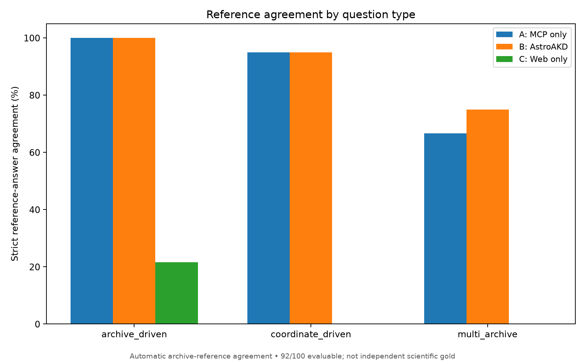
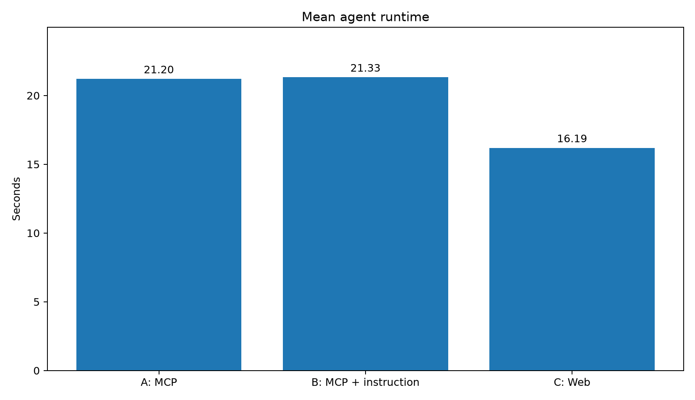

# Published example: `astroakd_100_v2`

The repository includes a [curated public example](https://github.com/danehkar/astroakd-bench/tree/main/examples/astroakd_100_v2) containing generated astronomy questions, independently collected Astroquery MCP reference answers, the A/B/C baseline answer samples, scoring summaries and figures. No live OpenAI or archive calls are necessary to inspect these saved outputs.

## Inspect the questions and references

- [All 100 questions joined with available reference answers](https://github.com/danehkar/astroakd-bench/blob/main/examples/astroakd_100_v2/astroakd_100_v2_questions_and_references.csv) — easiest spreadsheet overview, joined on `task_id`.
- [Original 100-question generation CSV](https://github.com/danehkar/astroakd-bench/blob/main/examples/astroakd_100_v2/astroakd_100_v2.csv) — question specifications, without collected reference values.
- [80 single-call references](https://github.com/danehkar/astroakd-bench/blob/main/examples/astroakd_100_v2/astroakd_100_v2_references.csv) and [20 multi-step reference statuses](https://github.com/danehkar/astroakd-bench/blob/main/examples/astroakd_100_v2/astroakd_100_v2_multistep_references.csv) — 12 completed multi-archive cases and 8 literature tasks without complete reference evidence.
- [Per-question classifications](https://github.com/danehkar/astroakd-bench/blob/main/examples/astroakd_100_v2/automated_scores_per_question.csv) and [scoring policy/summary](https://github.com/danehkar/astroakd-bench/blob/main/examples/astroakd_100_v2/automated_scoring_summary.json).

The joined CSV preserves structured values as JSON inside cells. **92 of 100** questions have complete independent reference evidence; the eight literature-driven cases are excluded pending confirmed publication-to-observation associations.

## Automatic archive-reference agreement

| Outcome | A: MCP only | B: AstroAKD instructions | C: Web only |
| --- | ---: | ---: | ---: |
| Strict reference matches | 87/92 | 88/92 | 13/92 |
| Strict agreement | **94.57%** | **95.65%** | **14.13%** |
| Partially correct | 4 | 4 | 2 |

**Interpretation:** The figures measure agreement with independently retrieved Astroquery MCP reference snapshots, *not independently reviewed scientific accuracy*. Only fully matching answers count in the strict percentage. The single-question difference between A and B is not established evidence of a domain-instruction benefit; several borderline output-format classifications merit review.

## Agreement by question type

## Original baseline runtime

The operational figures use the **original common-budget** A/B/C executions (100 questions per arm, 300 run records), without substituting subsequent higher-turn diagnostic retries. Reference coverage and runtime are different metrics.

For the methodology and report commands, see [Evaluation and plots](evaluation_and_plots.md). Additional PNG/SVG figures, archive breakdowns, and example JSONL files are listed in the [public examples README](https://github.com/danehkar/astroakd-bench/blob/main/examples/README.md).
