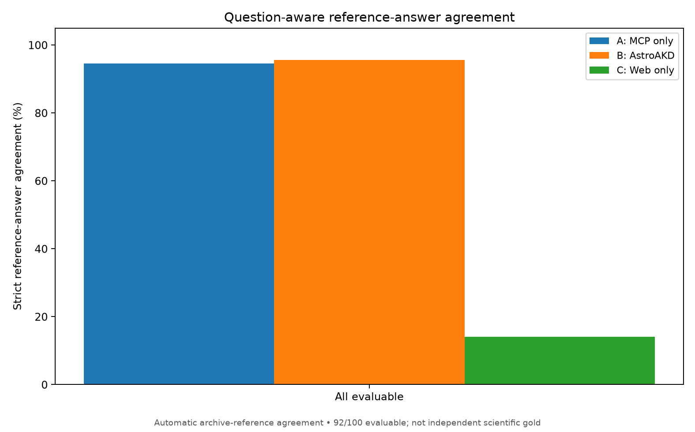

# AstroAKD-Bench

**Current documentation** for generating astronomy-search benchmark questions, collecting observable archive evidence, and evaluating AstroAKD across three agent configurations.

Start with [Getting started](benchmark/quickstart.md), including full installation of the external Astroquery MCP server. The independent [Astroquery MCP server](https://github.com/NASA-IMPACT/astroquery-mcp) provides the archive tools; an ADS token must be configured **on that server** if you require literature evidence.

```{toctree}
:maxdepth: 2
:caption: User guide

benchmark/quickstart
benchmark/create_queries
benchmark/ads_and_mcp
benchmark/references_and_review
benchmark/evaluation_and_plots
benchmark/example_results
benchmark/python_api
```

```{toctree}
:maxdepth: 1
:caption: Development

benchmark/documentation_build
```

## Example benchmark results

The [published `astroakd_100_v2` example](benchmark/example_results.md) contains all 100 questions, 92 independently retrieved reference-answer sets, per-question A/B/C classifications, and the generated figures below.



The percentages measure **automatic agreement with saved archive evidence**, not independently verified scientific accuracy. Eight literature tasks remain outside the scoring denominator.

## What the results mean

**Archive observations are unreviewed evidence, not automatically verified scientific answers.** A/B/C completion and tool-use plots measure agent behavior; independently reviewed gold references are required to report scientific accuracy.

The README and `CHANGELOG.md` cover the current interface and release changes. Historical version-specific documentation is intentionally excluded from the HTML site and preserved separately as archival evidence.

Frozen prompts: `instructions/astroakd/AstroAKD_Instruction.md` (arm B) and `instructions/astroakd_bench/AstroAKD-Bench_Instruction.md` (generation only).
