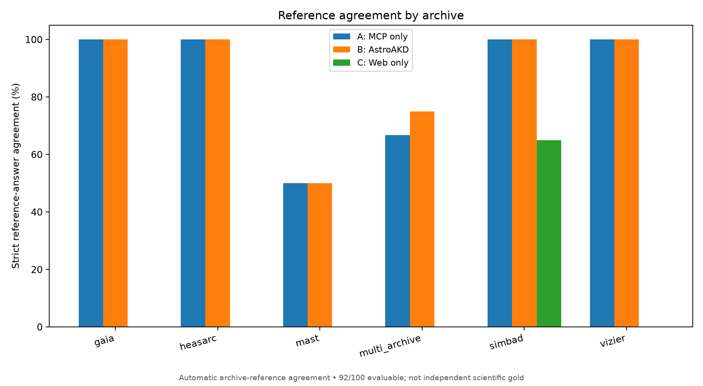
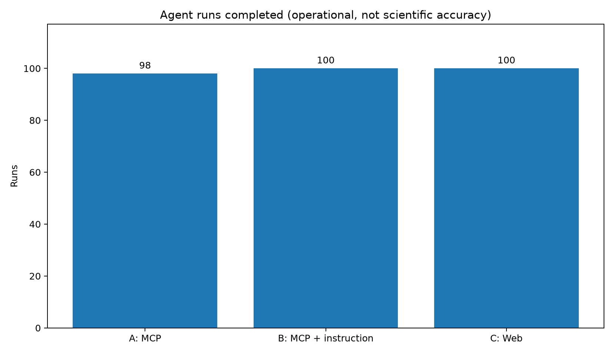

# AstroAKD-Bench: public example data and results

This directory demonstrates a frozen **`astroakd_100_v2`** benchmark study: automatically generated astronomical questions, independent Astroquery MCP reference evidence, three A/B/C agent configurations, and **question-aware reference-answer scoring**. It is a curated, compact public example; **not** the complete reproducibility archive.

## Explore the example

| File | Purpose |
| --- | --- |
| `astroakd_100_v2.csv` | **All 100 generated questions** and planned MCP query parameters; the original generation CSV does **not** contain collected reference answers. |
| `astroakd_100_v2_references.csv` | **80 collected single-call references**, including the answer values in `reference_answer_values_json`. |
| `astroakd_100_v2_multistep_references.csv` | **20 multi-step reference records:** 12 complete multi-archive cases and 8 literature cases pending independent evidence. |
| `astroakd_100_v2_multistep_references.jsonl` | Original 20-record multi-step evidence journal exported from the saved study. |
| `astroakd_100_v2_questions_and_references.csv` | **Convenience joined CSV: 100 question rows, 92 populated archive-reference answers, and 8 explicitly unavailable literature answers.** Join is by `task_id`; structured values retain field, row, and table indices. |
| `questions_sample.jsonl` | Ten synthetic questions, including original query definitions and answer specifications. |
| `reference_values_sample.jsonl` | Eight independently retrieved single-call archive-reference extracts. |
| `multi_archive_reference_sample.jsonl` | One completed two-archive reference (task `ASTROAKD-MIX-00009`), with archive-labelled evidence, but without the raw MCP tool responses. |
| `agent_answers_sample.jsonl` | A, B and C baseline responses for the ten sampled questions (30 records); raw traces removed. |
| `automated_scores_per_question.csv` | Classifications for **all 100 questions**, including exclusions. |
| `automated_scoring_summary.json` | Full 92-question scoring denominator, outcomes, caveats, and source SHA-256 identifiers. |
| `accuracy_breakdown.csv` | Breakdown by archive and question type, separately for all three arms. |
| `operational_summary.csv` | Runtime, token consumption and run completion from the original 300-run evaluation. |
| `figures/match_rate.{png,svg}` | **Latest** strict archive-reference agreement, on 92 evaluable questions. |
| `figures/accuracy_by_archive.{png,svg}` | Reference agreement by archive/task category. |
| `figures/accuracy_by_question_type.{png,svg}` | Reference agreement by question type. |
| `figures/{mean_runtime,total_tokens,completed_runs}.png` | Original baseline operational comparison (all 100 questions per arm). |
| `figures/questions_by_archive.png` | Question distribution from reference reporting. |
| `MANIFEST.json` | File checksums for the public example. |

For a spreadsheet overview, start with `astroakd_100_v2_questions_and_references.csv`; for original files, join `astroakd_100_v2.csv` with the reference CSVs on `task_id`. The sample JSONL records can also be joined by `task_id` (or `id` for question records). The sample includes a literature task without complete independent reference evidence; it is **not evaluable**, and no invented reference answer is supplied.

## Measured study results

**Study:** `astroakd_100_v2` / AstroAKD-Bench **0.6.7.11.12 question-aware scoring**, applied to the frozen baseline A/B/C experiment. **100 questions** total: 80 with completed single-call references, 12 with completed multi-archive references, and 8 literature-driven questions excluded because independent observation plans/paper associations are unavailable.

| Outcome | A: MCP only | B: MCP + AstroAKD instructions | C: Web only |
| --- | ---: | ---: | ---: |
| Correct (strict matches) | 87 / 92 | 88 / 92 | 13 / 92 |
| Strict archive-reference agreement | **94.57%** | **95.65%** | **14.13%** |
| Partially correct | 4 | 4 | 2 |
| Incorrect | 1 | 0 | 8 |
| Abstained | 0 | 0 | 69 |
| Original execution completion | 98 / 100 | 100 / 100 | 100 / 100 |
| Original mean runtime (seconds) | 21.20 | 21.33 | 16.19 |

Strict agreement counts only fully correct answers. Partial answers are not added to the strict-match numerator. These results measure **automatic agreement with independent Astroquery MCP archive observations**, **not externally adjudicated scientific accuracy**. One MCP-only classification (task `ASTROAKD-MIX-00046`, `2MASS J` identifier formatting) has been flagged as a possible parser-induced false negative; this archived scoring output is preserved without retroactively changing it.

The **operational** rows above come from the **original common-budget 300-run journal** (8-turn baseline); higher-budget selective retries are intentionally excluded. In particular, the original MCP-only arm has two execution errors outside the 92 evaluable questions. The legacy **69-question snapshot metric** is a different scoring method; its figures are intentionally **not** included.

## Figures

The plots below were created from the saved benchmark outputs and are included here as examples; SVG variants and additional archive, token-use, and completion plots are in [`figures/`](figures/).

## Source integrity and reproducibility

The `automated_scoring_summary.json` records the dataset question SHA-256, original A/B/C run SHA-256, and single-call reference SHA-256. Files here include the original generated-question CSV, extracted single-call reference CSV, multi-archive evidence records, and derived summaries; **full agent journals and raw MCP responses remain excluded** from the repository example. The eight literature questions have no supported reference answers, and must not be treated as incorrectly answered or as verified gold. For complete replication use the pinned benchmark source and an archived, checksum-verified copy of the full evidence dataset. The reference evidence is an archive-derived benchmark oracle, not reviewed scientific gold.

- [AstroAKD-Bench repository](https://github.com/NASA-IMPACT/astroakd-bench)
- [Astroquery MCP server](https://github.com/NASA-IMPACT/astroquery-mcp)
